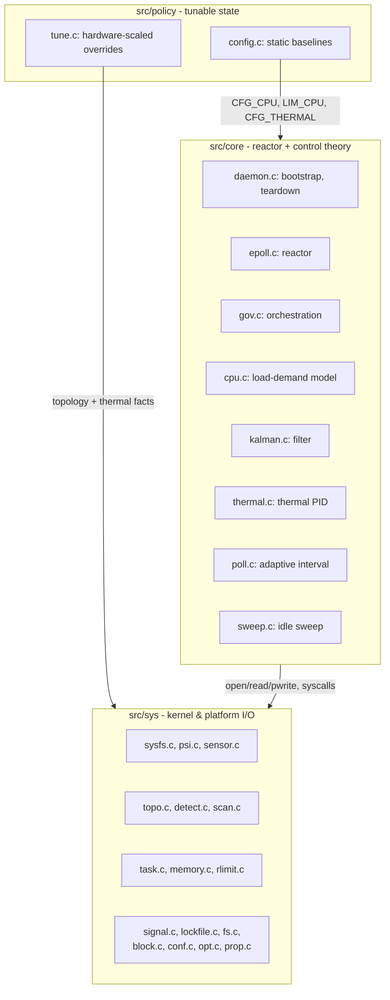
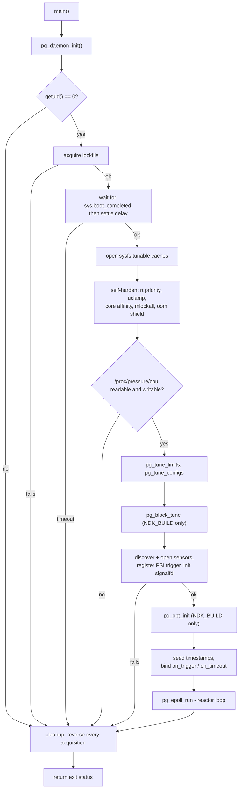
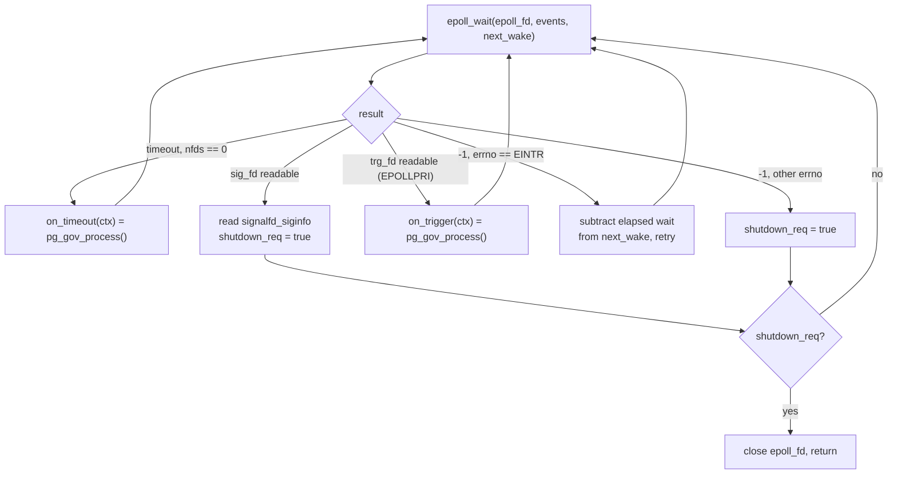
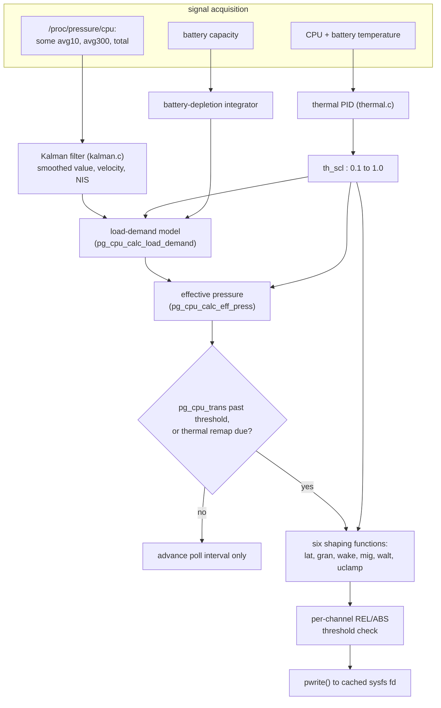
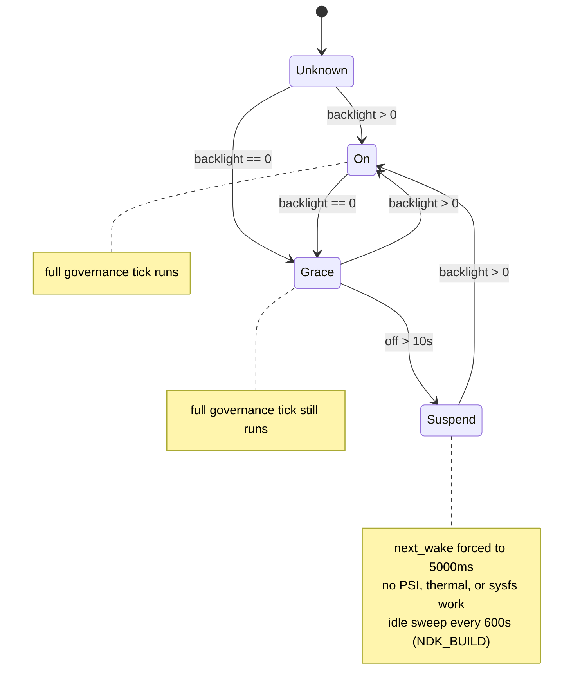

# Architecture

 `pgov` is a userspace daemon
for Android (`pgovd`) that adjusts six Linux scheduler tunables - CFS latency, minimum
granularity, wakeup granularity, migration cost, the WALT initial task load estimate,
and `uclamp_util_min` - in response to CPU pressure. It reads kernel PSI accounting from
`/proc/pressure/cpu`, filters the signal through an adaptive state estimator, and writes
the resulting values to sysfs, gated by thermal and battery state.

Three core constraints shape the codebase. First, execution is single-threaded with
no heap allocation in daemon code: there are no `pthread`, `malloc`, or `free` calls,
and all buffers reside on the stack or within a single static `pg_context` structure.
Heap usage is restricted to C library internals during boot-time discovery (such as Bionic `opendir()`),
while the idle sweep and per-tick paths use raw descriptors and `getdents64` to avoid
allocation failure paths and lock contention. Second, all signals in the control loop use
Q16.16 fixed-point integers (`q16_t`), restricting `float` and `double` types to compile-time
conversion macros. Third, although the daemon runs as root with `SCHED_FIFO` real-time priority,
it minimizes its resource footprint by pinning itself to the lowest-capacity CPU cluster, capping
its own `uclamp_max`, and relaxing its timer slack.

This document covers the source layout, process lifecycle, and per-tick control pipeline
from PSI sampling to sysfs actuation.

## Contents

1. [Source layout](#source-layout)
2. [Header conventions](#header-conventions)
3. [Build targets](#build-targets)
4. [Why fixed-point](#why-fixed-point)
5. [Runtime state](#runtime-state)
6. [Boot sequence](#boot-sequence)
7. [Hardening the process](#hardening-the-process)
8. [The reactor](#the-reactor)
9. [Finding the hardware](#finding-the-hardware)
10. [Reading PSI and filtering it](#reading-psi-and-filtering-it)
11. [Keeping thermals in check](#keeping-thermals-in-check)
12. [From pressure to scheduler knobs](#from-pressure-to-scheduler-knobs)
13. [Writing sysfs without spamming it](#writing-sysfs-without-spamming-it)
14. [Picking the next poll interval](#picking-the-next-poll-interval)
15. [Display state and idle housekeeping](#display-state-and-idle-housekeeping)
16. [Calibrating for the device it's running on](#calibrating-for-the-device-its-running-on)
17. [The optional config file](#the-optional-config-file)
18. [Shutting down](#shutting-down)

## Source layout

```
include/
├── block.h         conf.h        detect.h       fs.h
├── compiler.h      daemon.h      epoll.h        lockfile.h
├── memory.h        opt.h         parser.h       paths.h
├── prop.h          psi.h         rlimit.h       scan.h
├── sensor.h        str.h         sysfs.h        task.h
├── topo.h
└── pg/
    ├── config.h    cpu.h         gov.h          kalman.h
    ├── log.h       math.h        poll.h         signal.h
    ├── state.h     sweep.h       thermal.h      time.h
    └── tune.h

src/
├── main.c
├── core/
│   ├── cpu.c       daemon.c      epoll.c        gov.c
│   └── kalman.c    poll.c        sweep.c        thermal.c
├── policy/
│   └── config.c    tune.c
└── sys/
    ├── block.c     conf.c        detect.c       fs.c
    ├── lockfile.c  log.c         memory.c       opt.c
    ├── prop.c      psi.c         rlimit.c       scan.c
    ├── sensor.c    signal.c      sysfs.c        task.c
    └── topo.c
```

The source tree is divided into three layers. `src/sys/` contains mechanical OS and
I/O wrappers, including `open`/`read`/`pwrite` operations on sysfs and `/proc`,
`sched_setaffinity`, `sched_setattr`, `ioprio_set`, `mlockall`, `flock`, `signalfd`,
a raw `getdents64` directory walker, and Android property access; modules in this
directory perform I/O and return parsed values or error codes without making control
decisions. `src/core/` implements the reactor and all control algorithms, encompassing
the Kalman filter, thermal PID loop, load-demand tracker, adaptive polling logic, and
boot/shutdown orchestration. `src/policy/` defines the static baseline tables and the
startup calibration routine that scales those baselines to the detected hardware,
performing no I/O beyond calls delegated to `sys/`.



Control logic in `core/` and modules in `policy/` never touch raw file descriptors
or invoke I/O syscalls directly, routing all platform interactions through `sys/`.
Three orchestration files are exceptions: `epoll.c` manages the epoll and signalfd
descriptors it dispatches, `daemon.c` redirects `stderr` and writes captured baseline
values back via `pwrite()` inside the crash hook, and `sweep.c` walks directories using
`openat`, `fstatat`, and `getdents64`.

## Header conventions

Headers directly under `include/` use `PGOV_<NAME>_H` include guards, while headers
under `include/pg/` use `PG_<NAME>_H` guards. Every function crossing a file boundary
uses the `pg_` symbol prefix, except for the Q16/Q32 arithmetic primitives in `pg/math.h`.

The `include/pg/` subdirectory prevents naming collisions with standard C library
headers (`time.h`, `signal.h`, `math.h`) and common Android or vendor build headers
(`log.h`, `config.h`). Internal includes reference paths such as `pg/time.h` or
`pg/config.h` explicitly to avoid ambiguous path resolution, keeping all governor-domain
headers grouped under `include/pg/`.

Four headers do not strictly align with their implementation directory: `daemon.h`
and `epoll.h` sit in the root `include/` tree despite implementing `src/core/` reactor
logic, while `pg/log.h` and `pg/signal.h` sit under `include/pg/` for collision avoidance
despite wrapping OS primitives in `src/sys/`. Inline-only headers with no corresponding
`.c` translation unit are `compiler.h`, `str.h`, `parser.h`, `paths.h`, `pg/math.h`,
`pg/time.h`, and `pg/state.h`.

## Build targets

The project supports two C11 build targets compiled with `-Wall -Wextra -Werror`.
The primary target is CMake/NDK (`CMakeLists.txt`, `CMakePresets.json`), which configures
a `Ninja` build against `android-30` for `arm64-v8a` and `armeabi-v7a` with `Debug` and
`Release` presets. It compiles all sources under `src/**/*.c` except `main.c` into a static
library `pgov`, then links the `pgovd` executable against `pgov`, `android`, `log`, and `m`.
Defining `NDK_BUILD` via `target_compile_definitions(pgov PUBLIC NDK_BUILD)` enables all
standalone/Magisk features. Release builds add
`-O2 -ffunction-sections -fdata-sections -fvisibility=hidden -fno-math-errno -fno-signed-zeros -fno-trapping-math`,
LTO where supported, and stripped, section-GC'd linking
(`-Wl,--gc-sections -Wl,--icf=all -Wl,-s -Wl,--build-id=none -Wl,-O2 -Wl,--as-needed`).
For on-device compilation, `tools/termux.sh` installs `clang`, `cmake`, and `ninja` via `pkg`,
maps `uname -m` to the native ABI, and builds without the NDK toolchain file. `tools/mkmod.py`
stages release binaries into the module skeleton under `modules/` and packages
`dist/pgovd-<version>.zip` using the version from `modules/module.prop`.

The second target is Soong/AOSP (`android/Android.bp`) for direct integration into an Android
vendor tree (`vendor: true`), defining a thin-LTO static library (`libpgov`) and executable
(`pgovd`, launched by `pgovd.rc` and linked against `liblog`). This path omits `NDK_BUILD`
and excludes `main.c`, `sweep.c`, `conf.c`, `fs.c`, `opt.c`, and `block.c` from `libpgov`
via `exclude_srcs`. `tools/prepaosp.py` prepares the repository for vendor tree inclusion
by moving the four AOSP build files out of `android/` and removing NDK, CMake, and Magisk
files, leaving `include/`, `src/`, `LICENSE`, `README.md`, and `docs/`.

| Module / Header         | Behavior without `NDK_BUILD`                 |
| :---------------------- | :------------------------------------------- |
| `sweep.c`, `pg/sweep.h` | Idle cache sweep omitted                     |
| `conf.c`, `conf.h`      | Config parser omitted                        |
| `opt.c`, `opt.h`        | Sysfs/property overrides omitted             |
| `fs.c`, `fs.h`          | `getdents64` walker omitted                  |
| `block.c`, `block.h`    | Excluded via `exclude_srcs`                  |
| `prop.c`, `prop.h`      | Only `pg_prop_wait_boot()` retained          |
| `paths.h`               | Uses `/data/vendor/pgovd/`; no `CONF_PATH`   |
| `pg/config.h`           | `PG_SWEEP_IVL_SEC` undefined                 |
| `pg/state.h`            | `last_sweep` field omitted                   |
| `core/daemon.c`         | Block tune and opt init/exit omitted         |
| `core/gov.c`            | Sweep omitted; dormant sets `next_wake = -1` |

## Why fixed-point

All control loop signals use `q16_t` (`int32_t`, Q16.16) or, where intermediate products
would overflow 32 bits, `q32_t` (`int64_t`, Q32.32), defined in `include/pg/math.h`.
`Q16_TO_Q32` and `Q32_TO_Q16` wrap `q32_mul` calls requiring 64-bit intermediates.
`FLOAT_TO_Q16` accepts only compile-time literals (such as `FLOAT_TO_Q16(0.34F)`), whereas
`INT_TO_Q16` performs integer multiplication on both compile-time constants and runtime
values such as core counts and sensor readings.

`math.h` provides the underlying arithmetic and shaping primitives: `q16_mul` and `q16_div`
(where division by zero returns `INT32_MAX` or `INT32_MIN` by dividend sign rather than
trapping, and overflow wraps without saturation), a 64-bit integer square root and its Q16
wrapper, `pg_math_clamp`, `pg_math_lerp`, a rational sigmoid `pg_math_sigmoid(val, k, mid)`
evaluating $x / (1 + \vert{}x\vert{})$ with $x = k \cdot (\text{val} - \text{mid})$ rescaled into $[0, 1]$,
an exponential-decay approximation `pg_math_decay`, and an algebraic sigmoid `pg_math_alg_sig(x)`
evaluating $x / \sqrt{1 + x^2}$ (saturating past $\pm 180$ in real units). Two sanitizers convert
signed Q16 values into unsigned 64-bit integers for sysfs output: `pg_math_san_u64` (round-to-nearest)
and `pg_math_san_quant_u64` (millisecond-to-nanosecond scaling plus step quantization). `q32_mul`
selects between a 128-bit multiplication path when `__SIZEOF_INT128__` is defined and a four-way
32-bit partial-product fallback otherwise.

`parser.h` implements branch-light text parsing (`pg_parse_i32`, `pg_parse_u64`, `pg_parse_q16`)
and integer formatting (`pg_fmt_u32`, `pg_fmt_u64`), avoiding `sscanf` and `snprintf` during sysfs I/O.

## Runtime state

Mutable global state is confined to specific static structures. `static struct pg_context context`
in `daemon.c` holds the daemon's operational state. `LIM_CPU`, `CFG_CPU`, and `CFG_THERMAL` in
`policy/config.c` are statically initialized, updated once during boot by `pg_tune_limits()` and
`pg_tune_configs()`, and treated as read-only thereafter. Under `NDK_BUILD`,
`static struct pg_prop_state props[MAX_PROPS]` (64 entries) in `sys/opt.c` tracks property overrides
from the configuration file. Finally, `rs_tbl`/`rs_cnt` in `daemon.c` and `prev_act`/`crash_hook` in
`sys/signal.c` remain file-local statics so the signal handler can restore boot-time tunable values
and chain signal dispositions without a context pointer.

`struct pg_context` (`pg/state.h`), aligned to 64 bytes (`ALIGNED(64)`), consolidates
all per-tick state: the PSI monitor, four sensor handles (single descriptors for CPU
temperature, battery temperature, and battery capacity, plus an array of up to `PG_BL_MAX`
descriptors for multi-panel backlights), six `pg_sysfs_cache` entries, thermal loop state,
load-demand state, poll state, the display-state enum, cached battery metrics and thermal scale,
timestamps, four core descriptors (`epoll_fd`, `sig_fd`, `trg_fd`, `lock_fd`), `next_wake`
(poll timeout in milliseconds), consecutive error counters (`psi_fails`, `temp_fails`), state flags
(`remap_due`, `dormant`), `volatile bool shutdown_req`, and the `on_trigger`/`on_timeout` callbacks
bound to `pg_gov_process()`. Passing this single static instance by pointer eliminates dynamic
allocation during runtime.

## Boot sequence

`main()` discards `argv`, records binary provenance in `.note.pgov.author` and `.note.pgov.license`
ELF sections via `PGOV_AUTHOR` and `PGOV_LICENSE`, and returns the exit code of `pg_daemon_init()`.
Runtime configuration is read from the optional config file rather than command-line flags.



Every initialization failure jumps to a unified cleanup block. `init_context_defaults()`
sets all descriptors to `-1` before acquisition, and each cleanup routine in `sys/`
validates its handle before acting, making the same teardown sequence safe for both partial
and complete initialization. Boot polling checks `sys.boot_completed` up to `PG_BOOT_RETRY_MAX`
(300) times at `PG_BOOT_POLL_SEC` (1 s) intervals, then sleeps for `PG_STAB_DELAY_SEC` (10 s).
If `/proc/pressure/cpu` is not both readable and writable, initialization exits with `-ENODEV`.

## Hardening the process

`init_os_environment()` configures crash recovery, memory protection, resource limits,
and scheduling policy across `src/sys/`. For crash visibility (`signal.c`), a `SA_SIGINFO`
handler on `SIGSEGV`, `SIGFPE`, `SIGABRT`, and `SIGILL` logs the fault to `stderr`, runs a
one-shot hook that writes each tunable's captured boot-time value back via `pwrite()`,
forwards the signal to the previous handler (Bionic's `debuggerd` tombstone handler on Android),
and re-raises with the default disposition. `stderr` is redirected to `PG_PATH_LOG` before
handler installation so crash traces and `LOGE()` messages (`sys/log.c`) persist across reboots.

Memory protection (`memory.c`) writes `-1000` to `/proc/self/oom_score_adj` to prevent termination
by the kernel OOM killer or Android LMK, and locks pages via `mlockall` using
`MCL_CURRENT | MCL_FUTURE | MCL_ONFAULT` with a fallback to eager `MCL_CURRENT | MCL_FUTURE`
(logging a warning on failure rather than aborting). Resource limits (`rlimit.c`) raise `RLIMIT_NOFILE`
to its hard ceiling and clamp `RLIMIT_STACK` to `PG_STACK_SIZE` (512 KiB).

Task scheduling (`task.c`) pins CPU affinity to the lowest-capacity cluster (`pg_topo_set_little_core()`),
switches policy to `SCHED_FIFO` at `PG_RT_PRIORITY` (50), and sets timer slack to `PG_TIMER_SLACK_NS`
(50 ms; ignored by the kernel for RT tasks, leaving the daemon's $\pm 5\%$ PRNG jitter to de-align wakeups).
A raw `sched_setattr` syscall applies `PG_UCLAMP_MAX` (102 of 1024) alongside `sched_util_min = 0` under
`SCHED_FLAG_UTIL_CLAMP_MAX | SCHED_FLAG_UTIL_CLAMP_MIN | SCHED_FLAG_KEEP_POLICY | SCHED_FLAG_KEEP_PARAMS`,
overriding the default RT `uclamp_min` of 1024 so the kernel does not reject the lower maximum with `-EINVAL`.
I/O priority is set to best-effort class 2, priority 0 via `ioprio_set`, using architecture-specific syscall
number fallbacks (`aarch64`, `arm`, `x86_64`) where omitted by Bionic. Combining `SCHED_FIFO` with a clamped
`uclamp_max` prevents preemption while restricting the utilization attributed to the daemon; this ceiling is
lifted only during the idle cache sweep.

## The reactor

`pg_epoll_run()` creates an `epoll` instance monitoring two descriptors: `signalfd` from
`pg_signal_init()` (`EPOLLIN | EPOLLERR`) and the PSI trigger descriptor
(`EPOLLPRI | EPOLLERR | EPOLLET`, edge-triggered to match kernel PSI `POLLPRI` semantics).
The loop blocks on `epoll_wait(..., next_wake)` until `shutdown_req` becomes true.



Both `on_trigger` and `on_timeout` invoke `pg_gov_process()`, executing the same
governance tick on either a poll timeout or a kernel pressure threshold breach.
`pg_epoll_add_trg()` and `pg_epoll_rm_trg()` allow `gov.c` to replace the trigger
descriptor after a PSI read failure without tearing down the `epoll` instance.

## Finding the hardware

Because thermal-zone and backlight sysfs paths vary across vendors, `sys/scan.c` discovers
them dynamically at boot. `pg_scan_thermal_zone()` scans `/sys/class/thermal/thermal_zone*`
(up to 256 entries) and matches `type` in two passes: first against a priority list of known
vendor CPU zone names (`cpu`, `cpu0_thermal`, `mtktscpu`, `exynos_thermal`, `tsens_tz_sensor0`,
`big-core`, and other MediaTek, Qualcomm, Samsung, and HiSilicon names), and second via a
heuristic pass accepting names containing `cpu`, `soc`, `cluster`, or `ap` that are not on a
denylist (`battery`, `gpu`, `camera`, `wifi`, `pmic`, `backlight`, etc.). `pg_scan_backlight()`
walks `/sys/class/backlight/*` to open up to `PG_BL_MAX` (4) panel brightness nodes so
`pg_sensor_read_bl()` can evaluate maximum brightness across all displays. `pg_scan_trip_point()`
applies the same zone filters and inspects `trip_point_{0..9}_type` for `passive` or `critical`,
returning the matching `_temp` path on the first qualifying zone. Discovery routines use fixed-size
stack buffers and `str.h` helpers, with heap allocation limited to Bionic's `DIR` handle in `opendir()`
(also used by `pg_block_tune()` under `NDK_BUILD`).

`sys/sensor.c` wraps four sensor types using persistent descriptors and `pread`: CPU temperature
(millidegrees $\div 1000$), battery temperature (decidegrees $\div 10$ from `/sys/class/power_supply/battery/temp`),
battery capacity (percentage), and backlight brightness (raw integer). On open, I/O, parse, or range
failure (temperatures outside $-30\text{--}150^\circ\text{C}$, capacity outside $0\text{--}100$),
reads write a typed fallback ($65^\circ\text{C}$, $35^\circ\text{C}$, $100\%$, $0$) and return a
negative `errno`. Battery reads retain their fallback values, failed backlight reads count as
display-on, and CPU temperature failures hold the previous thermal scale for up to `PG_TEMP_FAIL_MAX`
(10) consecutive errors before feeding $0^\circ\text{C}$ to relax thermal restriction
(or from boot if no CPU thermal node exists). `pg_sensor_get_trip_temp()` discards trip points outside
$40\text{--}115^\circ\text{C}$ in favor of the fallback.

`sys/topo.c` obtains the core count via `sysconf(_SC_NPROCESSORS_CONF)` and reads
`/sys/devices/system/cpu/cpu%d/{cpufreq/cpuinfo_max_freq,cpu_capacity}` for maximum frequency
and per-core capacity (total, minimum, and maximum). `pg_topo_set_little_core()` constructs
a `cpu_set_t` from cores with the lowest `cpu_capacity` (falling back to lowest `cpuinfo_max_freq`,
or all cores with a warning if neither exists) and applies it via `sched_setaffinity(0, ...)`.
`sys/detect.c` verifies `/proc/pressure/cpu` read/write access and root privileges (`getuid() == 0`).

## Reading PSI and filtering it

`/proc/pressure/cpu` outputs lines formatted as `some avg10=<v> avg60=<v> avg300=<v> total=<v>`
(the `full` line on kernels 5.13+ is ignored). `pg_psi_read()` reads the `some` line in one
buffered `pread`, parsing `avg10` only on the initial read to seed the filter, `avg300` on every
read as a slow load baseline, and the monotonic microsecond counter `total` on every read to
compute the instantaneous stall rate:

```
delta = total_now - total_prev
rate  = delta * 100 / dt_us     (percent, Q16)
```

If `total` has not advanced since the prior read, the tick's measurement is 0. Deriving `rate`
directly from the cumulative counter avoids the fixed decay lag of `avg10` during rapid polling.

The computed `rate` (or initial `avg10`) feeds a two-state constant-velocity Kalman filter
(tracking position and velocity) shared with the thermal loop. Its $2 \times 2$ state covariance
propagates through a discretized process-noise matrix built from $dt$, $dt^2$, $dt^3$, and $dt^4$
terms. Noise parameters adapt each tick: the clamped innovation is squared and folded into a
$5\% / 95\%$ EMA of observed innovation covariance. Subtracting predicted position covariance from
this EMA yields the measurement noise `r_meas` (clamped to $[0.1, 50]$). Comparing the EMA against
the full predicted innovation covariance (position covariance plus `r_meas`) adjusts velocity process
noise `q_vel`: above prediction, `q_vel` increases by $5\%$ of the gap; at or below prediction, `q_vel`
decays by $5\%$ toward zero (clamped to $[0.01, 20]$). Normalized Innovation Squared (NIS) is calculated
from the unclamped innovation to detect structural breaks without outliers distorting the learned noise
floor. If elapsed time between reads exceeds 5 seconds, the filter resets before updating.

`pg_psi_open_trg()` registers the kernel monitor by opening `/proc/pressure/cpu` with
`O_RDWR | O_NONBLOCK` and writing `some <threshold_us> <window_us>\n`
(`PG_PSI_THRESHOLD_US` = 100000 $\mu\text{s}$ over `PG_PSI_WINDOW_US` = 1000000 $\mu\text{s}$).
`pg_psi_recov()` closes, reopens, and resets the filter upon read failure, while `pg_psi_read_raw()`
performs a stateless one-shot `avg10` read for the idle sweep interrupt check.

## Keeping thermals in check

`pg_thermal_update()` runs a PID controller with adaptive gains and anti-windup once every
`PG_THERM_CHK_SEC` (1 s), caching the output in `cached_th_scl` for intermediate ticks. It filters
CPU temperature through a dedicated Kalman filter instance initialized with `q_vel = 0.01`
(tighter than the PSI filter's `1.0` default) to obtain smoothed temperature and velocity estimates.

The temperature setpoint begins at `cfg->limit_cpu` and is reduced by up to $5^\circ\text{C}$ as
battery temperature approaches `cfg->limit_bat`. Proportional and integral gains scale inversely
with distance to the setpoint, and the derivative gain receives an additional boost during positive
velocity (heating). The integral term is clamped to $[-50, 50]$ and bleeds off via anti-windup
whenever the raw unsaturated output diverges from the saturated $[0, 100]$ output, at a rate that
increases with saturation duration.

The saturated output is inverted into the thermal scale factor
$\text{th\_scl} = 1 - u_{\text{sat}} / 100$, clamped to $[0.1, 1.0]$ during normal operation
(where $1.0$ means no restriction). If battery temperature reaches `cfg->limit_bat`, the clamp
tightens to $[0.1, 0.2]$. `th_scl` modulates load-demand gain, latency shaping, `uclamp` shaping,
and wakeup granularity.

## From pressure to scheduler knobs

The control pipeline converts filtered PSI, thermal scale, and battery metrics into six sysfs writes:



Battery level and temperature are sampled every `PG_BAT_CHK_SEC` (5 s) and thermal PID
runs every `PG_THERM_CHK_SEC` (1 s), with cached values consumed on intermediate ticks.

Effectiveness parameters are recomputed each tick from battery capacity, `th_scl`, and
the 300-second PSI baseline (`avg300`). A composite `health` factor
($\text{battery\_fraction} \cdot \text{th\_scl}$) scales response gain, surge gain, and
trend amplification, while `th_scl` alone scales lookahead and decay. Sigmoid midpoints
for latency and `uclamp` shift upward with `avg300` so sustained load requires higher
instantaneous pressure to trigger aggressive response. Scaling `avg300` by $0.1$ and
clamping to $[0, 1]$ yields a `noise` term ($10\%$ baseline equals $1.0$) that interpolates
the structural-break NIS threshold ($3.0$ to $12.0$), the load-demand damping ratio
($1.5$ to $3.5$), and trend gain ($0.99$ down to $0.85$). Meanwhile, the battery-depletion
integrator evaluates $97 \cdot ((100 - \text{level}) / 100)^3$ and computes its tick-to-tick
finite difference divided by a 5-second time constant ($\tau$), passing both values to the
load-demand model.

The load-demand model (`pg_cpu_calc_load_demand()`) treats running PSI as an overdamped
second-order system chasing a lookahead target
($\text{pred} = \text{tgt\_psi} + \text{vel} \cdot \text{lookahead}$). If incoming target
PSI is under $1.0$, velocity magnitude is under $0.01$, and tracked `psi_val` and `rate` are
already below those bounds, both reset to zero and the function returns immediately. Otherwise,
if the PSI filter's NIS exceeds `nis_thresh`, `psi_val` snaps to the raw target and `rate`
zeroes before force evaluation. When raw velocity magnitude exceeds `surge_thresh`, `rate`
receives an immediate additive nudge ($\text{vel} \cdot \text{surge\_gain}$) prior to computing
`pred`. The net force combines a proportional spring term
$k_{\text{fin}} \cdot (\text{pred} - \text{psi\_val})$ (where $k_{\text{fin}}$ incorporates response
gain, positive-velocity trend multiplier, and $\text{th\_scl}^2$), a damping dashpot term
$c_{\text{fin}} \cdot \text{rate}$ (where $c_{\text{fin}}$ is the larger of
$c_{\text{base}} / \sqrt{\text{th\_scl}}$ and a battery-integrator-scaled term capped at
$4 \cdot c_{\text{base}}$ and multiplied by $3.1$, with
$c_{\text{base}} = 2\sqrt{k_{\text{fin}}} \cdot \text{stab\_rat}$), and an integral term
$\text{integ} \cdot \text{psi\_val}$ capped at $1.5\times$ a reference magnitude derived from
$k_{\text{fin}}$. Net force is clamped to $\pm 32000$ (Q16), and velocity and position integrate
over `dt_safe` (`dt_real` clamped to $[2^{-16}\text{ s}, 100\text{ ms}]$). `psi_val` clamps to
$[0, 500]$, zeroing `rate` whenever that boundary is hit.

Load demand is multiplied by trend amplification to yield effective pressure,
which drives six `PURE` shaping functions:

| Tunable                         | Function                | Curve                    |
| :------------------------------ | :---------------------- | :----------------------- |
| `sched_latency_ns`              | `pg_cpu_calc_lat`       | Sigmoid / linear ceiling |
| `sched_min_granularity_ns`      | `pg_cpu_calc_gran`      | Fixed latency ratio      |
| `sched_wakeup_granularity_ns`   | `pg_cpu_calc_wakeup`    | Exponential decay        |
| `sched_migration_cost_ns`       | `pg_cpu_calc_migration` | Inverse-quadratic        |
| `sched_walt_init_task_load_pct` | `pg_cpu_calc_walt`      | Quadratic ramp           |
| `sched_uclamp_util_min`         | `pg_cpu_calc_uclamp`    | Thermal-scaled sigmoid   |

`pg_cpu_calc_lat` takes the minimum of a sigmoid response and a linear demand ceiling,
floored by a thermal term that rises as headroom shrinks. `pg_cpu_calc_gran` applies a
fixed ratio to latency and clamps the result so it never exceeds latency itself.
`pg_cpu_calc_migration` follows an inverse-quadratic curve in effective pressure and
reduces output by up to $50\%$ as velocity magnitude grows toward a 25-unit cap. The
first four functions output milliseconds (converted to nanoseconds in `gov.c` via `math.h` sanitizers)
and the last two output raw units. `gov_gate()` runs `apply_mapping()` only if `pg_cpu_trans()`
detects a transition (smoothed rate magnitude exceeds `trans_rate` or `psi_val` diverges from
`psi_ref` by more than `trans_diff`) or if `remap_due` was raised by a thermal update; active
transitions also clamp `next_wake` to at most `trans_poll`.

## Writing sysfs without spamming it

Each tunable maintains a `pg_sysfs_cache` holding its file descriptor, last-written value,
captured boot-time value, write-failure backoff state, and `active` flag, opened once at boot:

| Field        | `/proc/sys/kernel/` Node        | Unit             |
| :----------- | :------------------------------ | :--------------- |
| `sched_lat`  | `sched_latency_ns`              | ns               |
| `sched_gran` | `sched_min_granularity_ns`      | ns               |
| `sched_wake` | `sched_wakeup_granularity_ns`   | ns               |
| `sched_mig`  | `sched_migration_cost_ns`       | ns               |
| `sched_walt` | `sched_walt_init_task_load_pct` | $\%$             |
| `sched_ucl`  | `sched_uclamp_util_min`         | $0\text{--}1024$ |

For the first four nodes, `pg_sysfs_cache_init()` falls back to
`/sys/kernel/debug/sched/{latency_ns,min_granularity_ns,wakeup_granularity_ns,migration_cost_ns}`
on kernels 5.13+ where scheduler knobs reside in debugfs. If a node fails to open, its `active`
flag stays `false` and writes to that channel become no-ops while the remaining channels
continue operating. If all six nodes fail to open, the daemon enters dormant mode
(`dormant = true`): no PSI trigger is registered, and `pg_gov_process()` runs only `dormant_tick()`
(performing display upkeep and idle sweeps under `NDK_BUILD`, or setting `next_wake = -1` otherwise).

`pg_sysfs_update()` suppresses redundant writes using `PG_CHK_ABS` (absolute difference),
`PG_CHK_REL` (per-mille relative difference,
$\vert{}\text{cur} - \text{tgt}\vert{} \cdot 1000 \ge \text{cur} \cdot \text{tol}$), or
`PG_CHK_STRICT` (any change). Each cache initializes `last` to `UINT64_MAX`
so the initial write always executes:

| Tunable            | Mode | Limit | Effective Delta             |
| :----------------- | :--- | :---- | :-------------------------- |
| Latency            | REL  | 100   | $\ge 10\%$                  |
| Min granularity    | REL  | 100   | $\ge 10\%$                  |
| Wakeup granularity | REL  | 150   | $\ge 15\%$                  |
| Migration cost     | ABS  | 50000 | $\ge 50\text{ }\mu\text{s}$ |
| WALT init load     | ABS  | 5     | $\ge 5\%$                   |
| Uclamp min         | ABS  | 32    | $\ge 32$ units              |

Updates clearing their threshold call `pg_sysfs_write_strm()`, formatting the value with
`pg_fmt_u64()` and issuing a single `pwrite()` at offset 0 on the cached descriptor. One-shot
writes during boot (block-device tuning and config-file directives) use `pg_sysfs_write()`,
which opens, writes, and closes the file on each call.

## Picking the next poll interval

`pg_poll_calc_next()` predicts pressure 0.5 seconds ahead
($\text{pred} = \text{cur\_press} + \text{press\_vel} \cdot 0.5$). Predicted pressure
over 5 or velocity over 2 snaps the interval immediately to `PG_MIN_POLL_MS` (100 ms);
predicted pressure over 1.5 halves the current interval; if the 300-second baseline is
under 2 and neither faster condition applies, the interval grows by 200 ms. The output
is clamped to $[100\text{ ms}, 10000\text{ ms}]$.

Downscaling takes effect immediately on workload surges, whereas interval relaxation
requires a change of at least 200 ms to prevent boundary jitter. If elapsed wall-clock
time since the previous call exceeds the last requested wait (including jitter) plus a
200 ms tolerance, the interval resets to `PG_MIN_POLL_MS`. Before returning, the interval
is rounded to the nearest 50 ms and perturbed by up to $\pm 5\%$ via a seeded PRNG
(64-bit LCG with 128-bit multiply-and-shift when available, or xorshift fallback).

## Display state and idle housekeeping

`update_disp()` runs at the beginning of each tick and
gates execution across four display states:



A failed backlight read is treated as `On`. Waking from `Suspend` to `On` resets
`load_state.first_run` and the PSI Kalman filter so the first tick after wake
starts from a fresh measurement. The 10-second `Grace` window prevents brief
screen-off events from interrupting governance.

Under `NDK_BUILD`, `pg_sweep_run()` executes every `PG_SWEEP_IVL_SEC` (600 s)
while in `Suspend`. It raises the daemon's `uclamp_max` ceiling to `UCLAMP_UNRESTRICTED`
(1024) during the pass and restores `PG_UCLAMP_MAX` (102) afterward. Using the raw
`getdents64` walker in `fs.c` (max depth 12, never following symlinks), it walks every
package `cache` directory under `/data/data` and `/data/media/0/Android/data` along with
three thumbnail directories, deleting regular files older than 24 hours. The sweep checks
for interruption every 1024 files and aborts immediately if the backlight turns on, raw
PSI `avg10` exceeds 3, or the system clock predates a compile-time epoch.

## Calibrating for the device it's running on

`pg_tune_limits()` and `pg_tune_configs()` run once after the PSI availability check
and interpolate `LIM_CPU`, `CFG_CPU`, and `CFG_THERMAL` in place using four hardware
indices. `cap` drives all `LIM_CPU` fields as a blend of $40\%$ core-count ratio
(against 8 cores) and $60\%$ max-frequency ratio (against 3500 MHz), without consulting
EAS data. `rel` drives `CFG_CPU` and `CFG_THERMAL` using total EAS `cpu_capacity` normalized
against 8192 when both capacity and max frequency are readable, falling back to the `cap`
blend otherwise. `rat` measures cluster heterogeneity as the lowest-to-highest cluster
capacity ratio when EAS data exists, or $0.5$ above 4 cores and $1.0$ at or below 4 cores.
`therm` evaluates $\text{rel} \cdot (\text{max\_freq\_mhz} / 3500)$, clamped to $[0, 1]$.

| Field                   | Base                 | Range                         | Metric                          | Scaling |
| :---------------------- | :------------------- | :---------------------------- | :------------------------------ | :------ |
| `LIM_CPU.min_lat`       | $8.0\text{ ms}$      | $4.0\text{--}20.0\text{ ms}$  | `cap`                           | Inverse |
| `LIM_CPU.max_lat`       | $20.0\text{ ms}$     | $12.0\text{--}25.0\text{ ms}$ | `cap`                           | Inverse |
| `LIM_CPU.min_gran`      | $2.5\text{ ms}$      | $1.5\text{--}6.5\text{ ms}$   | `cap`                           | Inverse |
| `LIM_CPU.max_gran`      | $6.5\text{ ms}$      | $4.0\text{--}10.0\text{ ms}$  | `cap`                           | Inverse |
| `LIM_CPU.min_wake`      | $1.5\text{ ms}$      | $1.0\text{--}3.0\text{ ms}$   | `cap`                           | Inverse |
| `LIM_CPU.max_wake`      | $6.5\text{ ms}$      | $4.0\text{--}8.0\text{ ms}$   | `cap`                           | Inverse |
| `LIM_CPU.min_mig`       | $0.2\text{ ms}$      | $0.2\text{--}0.6\text{ ms}$   | `cap`                           | Inverse |
| `LIM_CPU.max_mig`       | $0.6\text{ ms}$      | $0.6\text{--}1.2\text{ ms}$   | `cap`                           | Inverse |
| `LIM_CPU.max_ucl`       | $384$                | $384\text{--}1024$            | `cap`                           | Direct  |
| `CFG_CPU.lat_gran_rat`  | $0.34$               | $0.20\text{--}0.50$           | `rel`                           | Inverse |
| `CFG_CPU.uclamp_k`      | $0.185$              | $0.12\text{--}0.25$           | `rat`                           | Direct  |
| `CFG_CPU.sigmoid_k`     | $0.072$              | $0.04\text{--}0.12$           | `rat`                           | Direct  |
| `CFG_CPU.surge_thresh`  | $17.5$               | $12.0\text{--}25.0$           | `rel`                           | Direct  |
| `CFG_CPU.trans_rate`    | $0.115$              | $0.08\text{--}0.20$           | `rel`                           | Direct  |
| `CFG_CPU.trans_diff`    | $0.58$               | $0.40\text{--}0.90$           | `rel`                           | Direct  |
| `CFG_THERMAL.limit_cpu` | $52.5^\circ\text{C}$ | $45\text{--}90^\circ\text{C}$ | $\text{trip} - 5^\circ\text{C}$ | Direct  |
| `CFG_THERMAL.limit_bat` | $40.5^\circ\text{C}$ | $38\text{--}42^\circ\text{C}$ | `therm`                         | Inverse |
| `CFG_THERMAL.ki_base`   | $0.0095$             | $0.005\text{--}0.015$         | `therm`                         | Direct  |
| `CFG_THERMAL.kp_base`   | $0.61$               | $0.45\text{--}0.90$           | `therm`                         | Direct  |
| `CFG_THERMAL.kd_base`   | $0.82$               | $0.60\text{--}1.30$           | `therm`                         | Direct  |

For `CFG_THERMAL.limit_cpu`, if no valid thermal trip point is detected, a fallback
trip temperature of $57.5^\circ\text{C}$ is used (yielding $52.5^\circ\text{C}$).
`pg_tune_limits()` leaves `LIM_CPU` untouched if either core count or max frequency
cannot be read, whereas `pg_tune_configs()` substitutes defaults of 8 cores and 2000 MHz
for missing values. `LIM_CPU.min_walt`, `LIM_CPU.max_walt`, `LIM_CPU.min_ucl`, and
`CFG_CPU.trans_poll` remain at their static `config.c` baselines
($10.0$, $40.0$, $0$, and $50\text{ ms}$).

## The optional config file

Under `NDK_BUILD`, `pg_opt_init()` parses `CONF_PATH` (`/data/adb/modules/pgovd/system/etc/pgovd.conf`)
via the streaming parser in `conf.c`, which feeds a 256-byte line buffer from a 4 KiB read buffer in
fixed-size chunks. Parsed directives execute as one-shot `sysfs.*` writes or `prop.*` overrides as
specified in [`CONFIGURATION`](CONFIGURATION.md). `pg_prop_wait_boot()` (`sys.boot_completed` polling)
is compiled and executed on both build targets.

## Shutting down

Every resource acquired by `pg_daemon_init()` is released along a single teardown sequence, whether triggered
by `shutdown_req` (`SIGINT`, `SIGTERM`, or `SIGHUP` via `signalfd`, or a fatal `epoll_wait` error) or by an
initialization failure. Modified sysfs tunables are restored to their captured boot-time values first, followed
by reverting property overrides, closing the trigger and signal descriptors, releasing the lockfile, closing
the PSI monitor and all four sensor handles, and releasing all six sysfs caches.
